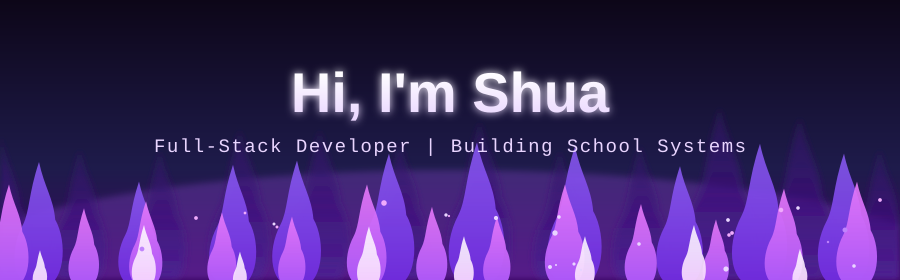

<!-- ============================================================
  PURPLE GITHUB PROFILE README
  1. Replace every shuuhatsu with your GitHub username.
  2. Edit anything marked with ✏️
  3. Delete any section you don't want.
============================================================= -->

<!-- ───────────── HEADER BANNER ───────────── -->

<!-- ───────────── TYPING ANIMATION ───────────── -->
<!-- ✏️ Change the lines= part. Separate each line with a semicolon, use + for spaces -->

 

---

## 💜 About Me

<!-- ✏️ Edit these bullets. Keep them short and personal. -->
- 🔭 I'm currently working on **school management systems** (attendance, enrollment, grades, dormitory)
- 🌱 I'm learning **[something new: e.g. Laravel / Vue / Docker]**
- 💬 Ask me about **PHP, CodeIgniter, MySQL, payment integrations**
- ⚡ Fun fact: **[something fun about you]**
- 📫 Reach me at **[your email or social link]**

---

## 🛠️ Tech Stack

<!-- ✏️ Add or remove badges. Browse more at https://shields.io and https://simpleicons.org -->

---
<!--
## 📊 GitHub Stats

---

## 🚀 Featured Projects

<!-- ✏️ Replace with your real projects. Pin repos on your profile too. 
| Project | What it does | Stack |
|---|---|---|
| 🎓 **[Project Name](https://github.com/shuuhatsu/repo)** | Student attendance with SMS guardian alerts | PHP, CodeIgniter, MySQL |
| 💳 **[Project Name](https://github.com/shuuhatsu/repo)** | Online enrollment with payment integration | PHP, JavaScript |
| 🪪 **[Project Name](https://github.com/shuuhatsu/repo)** | Auto-generated ID cards | PHP, GD Library |

<!-- Tip: private/client work? Describe it generically, or build a small public demo. 

---

## 📈 Contribution Graph

---

## 🏆 Achievements / Currently Exploring

<!-- ✏️ Optional. Certificates, milestones, goals, or things you're studying.
- ✅ [Milestone, e.g. Built a full enrollment + payment flow]
- ✅ [Another achievement]
- 🎯 Goal: [what you're aiming for next]

---

## 🤝 Let's Connect

<!-- ✏️ Replace the links. Remove any you don't use.

 

*"Ship it, then make it better." 💜*

-->
<!--
 -->

 
